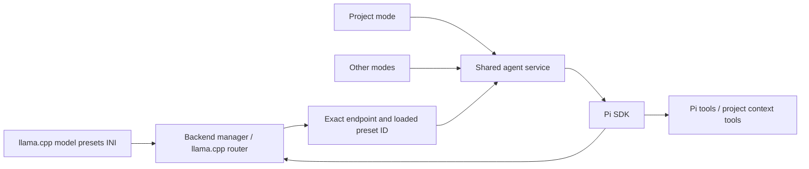

# Shared agent service

This is the first shared agent adapter for project mode and other application
callers. Pi 0.87.1 supplies the model transport, tool execution loop, conversation
sessions, and compaction. Franco supplies the backend binding, session controls,
and application feedback. The native UI is not connected to this worker yet.

## Ownership



The INI owns loader settings such as model paths, GPU placement, and context
size. Agent controls own compaction and thinking requests. The adapter reads
the actual loaded context from `/props?model=<exact-id>&autoload=false`; it does
not copy INI values into a second model registry. It checks `/models` and binds
the exact loaded ID. Missing or unloaded models return a visible error. The
adapter never starts another server, loads a model, or picks a fallback model.

Current llama.cpp supports `llama-server --models-preset <path-to-ini>` in router
mode, without `-m`. The file can be named `model.ini`, `models.ini`, or another
name. Its sections are preset IDs, and its keys are server arguments without
leading dashes. Model-specific loader options should stay in the INI: global
command-line options can override them. See [model presets](https://github.com/ggml-org/llama.cpp/blob/master/tools/server/README.md#model-presets)
and [Pi's router integration](https://github.com/earendil-works/pi/blob/main/packages/coding-agent/docs/llama-cpp.md).

Franco's existing native `/load` still starts single-model servers. Migrating
that UI and its current registry to the router is the next integration step.

## Run and verify

Use Node.js 22.19 or newer. From this directory:

```powershell
npm ci --no-audit --no-fund
npm test
node worker.mjs
```

`worker.mjs` exchanges UTF-8 JSON lines over stdin/stdout. Use `node` directly
when embedding it; npm's startup banners are not protocol frames. This is a
developer entry point, not the final project-mode user interface. The C host
needs bidirectional process pipes and continuous asynchronous reading; the
existing `FbProcess` API currently supports file output and no input pipe.

## Session controls

| Control | Meaning |
| --- | --- |
| `thinkingLevel` | Requested Pi effort: off, minimal, low, medium, high, xhigh, max |
| `compaction.enabled` | Enable automatic compaction; manual compaction remains callable |
| `compaction.reserveTokens` | Explicit headroom and Pi summary budget input |
| `compaction.keepRecentTokens` | Recent history token estimate retained by Pi |
| `outputTokens` | Output ceiling selected when opening the session |

Compaction budgets are mandatory. Reserve plus recent history must leave space
in the loaded context, and reserve must cover the output ceiling. These are
capacity checks, not evidence that a particular task will fit: instructions,
tool schemas, results, and the summary prompt also consume space.

Thinking capabilities come from the loaded template. An `enable_thinking`
template exposes Pi's off/medium switch; a nonreasoning template exposes off.
For a template reporting `supports_reasoning_effort`, the host supplies
`effortLevels` for the specific model after qualifying those levels. A boolean
capability alone does not establish that every possible tier works. Until
qualified levels are supplied, the adapter exposes off. Requested and effective
levels are both returned. Sending a level is not proof that it improves results.

`request_settings` events and `lastRequest` report the model ID, output cap, and
thinking controls actually sent. Pi can lower the output ceiling to fit its
estimated remaining context. In a synthetic 8192-token compaction case with a
large history, Pi 0.87.1 sent a one-token cap. Its current simple request path
subtracts an additional 4096-token margin. Real small-context qualification must
exercise this path; these tests do not establish a usable minimum context.

Settings changes apply when idle. Changing loader settings requires reloading
through the backend and reopening the agent session. The adapter rechecks model
ID, path, context, build, and template capability before prompt or compaction.
It cannot make a router inspection and inference atomic; the backend manager
must coordinate unload/reload with active sessions when the native UI is wired.

## Protocol

Every request uses a unique nonempty string `id` and a `method`. The host supplies
an absolute workspace, its exact loaded backend ID, and an explicit tool list:

```json
{
  "id": "open-1",
  "method": "open",
  "params": {
    "cwd": "C:/work/example",
    "routerUrl": "http://127.0.0.1:8080",
    "modelId": "my-local-preset",
    "tools": ["read", "grep", "find", "ls"],
    "controls": {
      "thinkingLevel": "off",
      "outputTokens": 1024,
      "compaction": {
        "enabled": true,
        "reserveTokens": 2048,
        "keepRecentTokens": 2048
      }
    }
  }
}
```

Those numbers are an example for an 8192-token fixture, not production defaults
or a 4B recommendation. The real profile must be qualified with the real model.

| Method | Params / behavior |
| --- | --- |
| `open` | Binding, controls, tool list, workspace; optional absolute `sessionDirectory` or `sessionFile` |
| `get_state` | Binding, session identity, requested/effective controls, usage, last request |
| `configure` | `thinkingLevel` and/or a complete `compaction` object; validation occurs before either changes |
| `prompt` | `{ "message": "..." }`; response after Pi settles, while events stream |
| `compact` | Optional `{ "instructions": "..." }`; uses the same bound model |
| `abort` | Cancels active preparation/inference and waits for completion |
| `close` | Aborts and disposes the session; worker remains available |

Replies are `{ "type": "response", "id": "...", "ok": true, "data": ... }`
or the same envelope with `ok: false` and `error`. Events use
`{ "type": "event", "runId": "prompt-request-id", "event": ... }`.
The host must read continuously, correlate responses by ID, and show tool,
compaction, retry, failure, and cancellation events. Prompt responses report
`completed`, `failed`, `aborted`, or `incomplete` and the original stop reason.
A token-limit reply is incomplete. A completed run is not a verified patch:
the project workflow must run its actual regression checks and inspect changes.

Pi tools include filesystem writes and shell execution when explicitly enabled.
Setting `cwd` chooses their starting workspace; it is not an OS sandbox. The
project host supplies the agreed working copy and tool policy. No new approval
system is implemented by this adapter.

## Retention and data flow

Without a session path the session is in memory. With `sessionDirectory`, Pi
stores a local conversation/tool history; `sessionFile` resumes it only in its
original workspace. This history can contain source and tool output. Compaction
changes model context while Pi retains the underlying transcript.

The host must explain the chosen session location in the project UI. The initial
adapter targets a keyless local router and does not read Pi's global auth or model
settings. All inference and summaries use the supplied endpoint. Configuring an
authenticated or remote backend requires an explicit data/auth design before
adding credential storage. Resource discovery includes project instructions;
automatic extension, skill, prompt-template and theme discovery is disabled.

## Evidence

The tests run the real pinned Pi SDK against a synthetic HTTP/SSE router. They
cover exact model binding, thinking mapping, output settings, tool failures,
manual compaction, capacity validation, backend changes, inference failure,
cancellation, persistent sessions, and the subprocess protocol. They do not
load a GGUF or establish 4B task accuracy, latency, or compaction quality.
